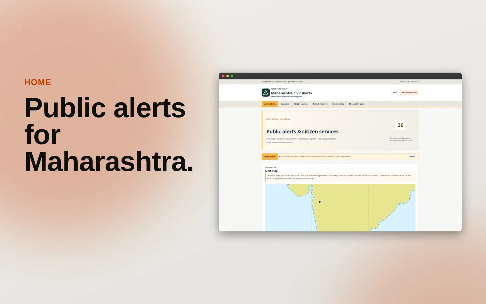
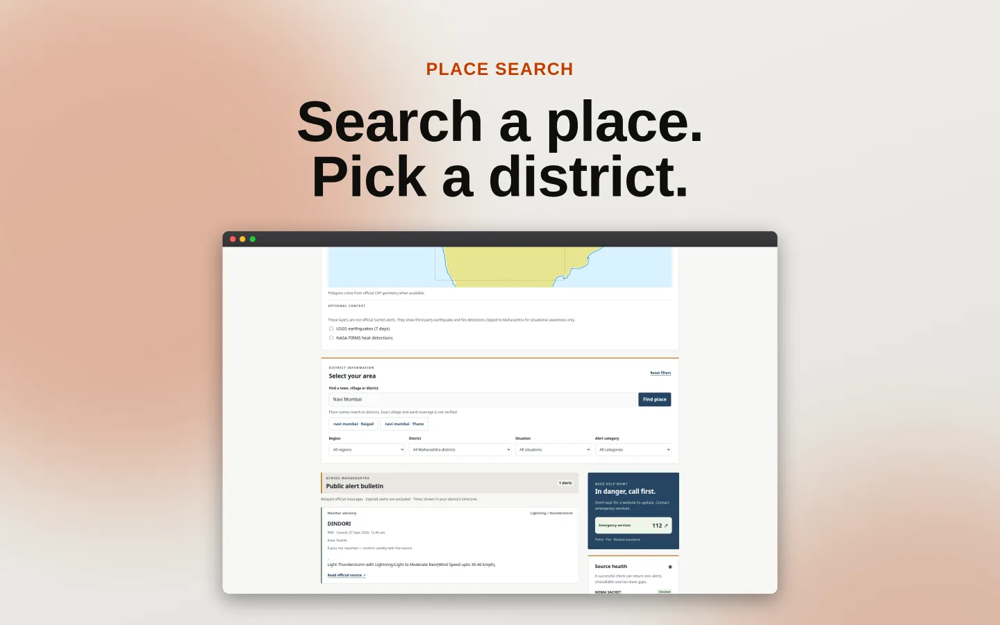
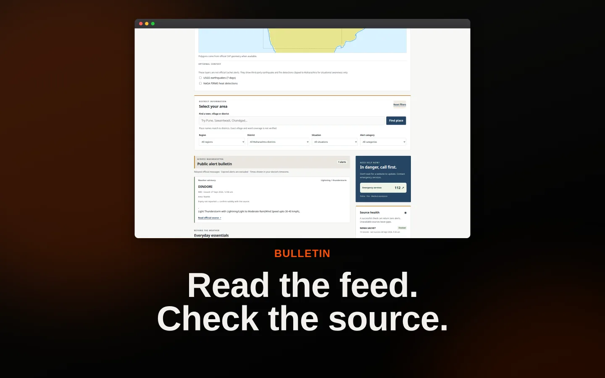
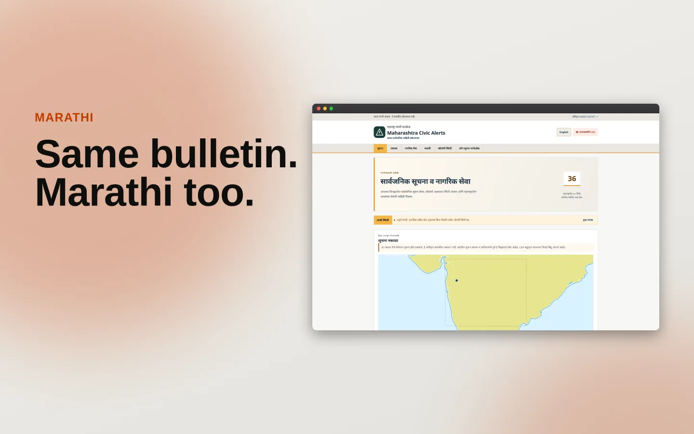

# Maharashtra Civic Alerts

Independent English/Marathi hub for official Maharashtra public alerts, district search and service directories.

**This is not a government website or an emergency dispatch service.** In immediate danger call **112**. Zero relayed alerts does not mean an area is safe.

**Use it live:** [maharashtra-sachet.mangeshraut712.workers.dev](https://maharashtra-sachet.mangeshraut712.workers.dev)

**Metro Hackathon pitch:** [live slides](https://maharashtra-sachet.mangeshraut712.workers.dev/pitch) · [60-second script](https://maharashtra-sachet.mangeshraut712.workers.dev/pitch#s3)

## Hackathon demo

**DevDay Exchange Community Metro Hackathon Pune · Codex Dayline · Civic + Urban Mobility.** Metro Sachet adds a Vanaz ↔ Ramwadi ride view to the civic relay. This corridor is Pune Metro's **Line 2 / Aqua Line** ([official route reference](https://www.punemetrorail.org/download/Pune_Metro_AquaLine.pdf)). Its 16 stations all map to **Pune district**, with `district-alias` precision only. A district notice does not establish an incident at any station, a train delay, or a safe route.

| Entry | URL |
| --- | --- |
| Live hub | [maharashtra-sachet.mangeshraut712.workers.dev](https://maharashtra-sachet.mangeshraut712.workers.dev/) |
| Full judge path, with sample data | [/?demo=1](https://maharashtra-sachet.mangeshraut712.workers.dev/?demo=1) |
| Direct Metro sample view | [/metro?demo=1](https://maharashtra-sachet.mangeshraut712.workers.dev/metro?demo=1) |
| Live Metro district view | [/metro](https://maharashtra-sachet.mangeshraut712.workers.dev/metro) |
| Pitch and 60-second script | [/pitch](https://maharashtra-sachet.mangeshraut712.workers.dev/pitch) (also reachable from `/pitch.html`) |

**Judge path:** home → **Along my Metro ride** → **DEMO / sample data** → labelled Pune notice → **Explain in plain words** → **मराठी**. Starting at `/?demo=1` preserves demo mode into the ride. The fixture path works even when live CAP is empty or unavailable. Demo notices are never inserted into the live bulletin or represented as government alerts. The explainer uses the existing Gemini endpoint and clearly labels its keyword-based offline fallback when Gemini is unavailable.

**60-second script:** “This is Metro Sachet, an independent civic companion for Pune’s Vanaz–Ramwadi ride. From home, open Along my Metro ride. These sixteen stations map to Pune district only, not individual station warnings or train status. Open DEMO / sample data and the labelled Pune notice. The walkthrough works even when live feeds are empty. Explain in plain words uses Gemini; switch to Marathi. A visible offline fallback covers model failure. The original source remains the authority. Samples never become live alerts. Empty does not mean all-clear. In immediate danger, call 112. Built with Codex, Cloudflare Workers, D1, and Gemini.”

For a venue-network fallback, install dependencies before arriving, then run the local fixture server:

```sh
npm ci
npm run demo
# http://127.0.0.1:8799/?demo=1
# http://127.0.0.1:8799/metro?demo=1
# The local explainer works without a Gemini key, with a visible offline fallback.
```

The demo is an independent civic project, not a government site or emergency service. It does not originate cell broadcast, Wireless Emergency Alerts, or IPAWS. Optional Jev, situational, and CPCB layers stay off. Coverage remains exactly 36 Maharashtra districts; Goa is excluded. An empty feed is not an all-clear; in immediate danger, **call 112**.

Deployment uses the existing Wrangler production configuration:

```sh
npm test
npm run typecheck
npm run test:e2e
npm run deploy:production
# Equivalent: npx wrangler deploy --env production
```

Wrangler needs access to the configured Cloudflare account and D1 database. See [operations](docs/OPERATIONS.md) for authentication and secrets; do not place keys in browser code.

## Screenshots

Framed captures of the live hub (current UI). An empty or partial bulletin is not an all-clear. In danger, call **112**.

<div align="center">









</div>

## How to use (in short)

1. Open the site. Read the independent-project banner and **Latest status**.
2. Search a place (Pune, Sawantwadi, Navi Mumbai) or pick a district. Place names map to a **district**, not a verified village/ward boundary.
3. If two districts appear (Navi Mumbai → Raigad and Thane), choose the one that matches your area.
4. Read **Source health** before treating an empty bulletin as “all clear”.
5. Use **Citizen services** for official portals. Directory links are not live incident feeds.
6. Switch to **मराठी** when needed. Optional notifications only work while the page is open.

Full walkthrough and dated status notes: [How to use](docs/HOW-TO.md) · [Recorded snapshot](docs/STATUS.md)

## Historical live snapshot (6 September 2026)

Verified **6 Sept 2026, 00:59 IST** against production version `6645d3eb-b2e0-4070-bc55-81c18fc5f2af`. The one-minute scheduler advanced the healthy generation from `2026-09-05T19:27:58.576Z` to `2026-09-05T19:28:58.319Z`. Feeds and health can change after this snapshot.

| Check | Result |
| --- | --- |
| Production health | HTTP 200, `status: healthy`, generation advanced within 60 seconds |
| Active alerts | **0** (expired CAP records are excluded) |
| SACHET | Healthy, **10** retained source records; none currently active |
| IMD / INCOIS | Healthy checks, **0** current source records |
| CWC / CPCB | Explicitly **disabled** (not connected) |
| Districts | All **36** listed; none had a live alert in this snapshot |
| Place search | Navi Mumbai → Raigad + Thane; Sawantwadi → Sindhudurg; Marunji → Pune, all labelled district aliases |

Staging version `d4af16ea-0bdc-41c4-bb52-35f416ce58d1` also passed desktop/mobile deployment tests and advanced from `19:29:58.101Z` to `19:30:58.545Z`. See the [dated verification report](docs/REALTIME-DEMO-VERIFICATION-2026-09-06.md).

## Run locally

Node.js 24 LTS (see `.node-version`) and npm:

```sh
npm ci
npm start
# http://127.0.0.1:8787  live public sources

npm run demo
# http://127.0.0.1:8799  labelled fixture alerts, separate from live data
```

```sh
npm test                 # offline tests; live network checks skipped
npm run typecheck
npm run test:e2e         # after: npx playwright install --no-shell chromium
npm run verify:realtime  # read-only proof of two advancing production generations
```

Deploy, rollback and secrets: [operations](docs/OPERATIONS.md). API: [docs/API.md](docs/API.md). All docs: [docs/README.md](docs/README.md).

## Alert explainer (Gemini)

`/explain` (served from `web/explain.html`; API `POST /api/explain`) turns a pasted public alert, or a labelled sample, into a plain-language summary, what it means for the named district, three safety steps, and Marathi and Hindi versions. The severity badge shows only a level stated in the alert ("Not stated" otherwise). Each alert card has an "Explain in plain words" link that prefills the page.

Built with Google AI Studio + Gemini. The model defaults to `gemini-3.8-flash` (override with the `GEMINI_MODEL` var). The key is read only from the Worker secret; caller-supplied keys are ignored:

```sh
npx wrangler secret put GEMINI_API_KEY --env production
```

Without a key, or if Gemini fails, the API returns a keyword-based offline fallback and the page shows a visible note. The same route is served by the Worker and by `npm start`. Requests are JSON, size-capped, same-origin when a browser sends `Origin`, and rate-limited. Not a government site. Verify with official sources (sachet.ndma.gov.in, IMD). Emergency: call 112.

## Open source / Fork this

This is an **MIT** civic CAP relay meant to be forked, and it is **not a government website**. Another Indian state or region can reuse the pipeline by replacing district/LGD tables, feed adapters, and branding—while keeping the same safety rules: unofficial relay, **CAP is the sole authority**, call **112**, no cell-broadcast / WEA / IPAWS origination.

**Live demo:** [maharashtra-sachet.mangeshraut712.workers.dev](https://maharashtra-sachet.mangeshraut712.workers.dev) (independent Worker; not `.gov.in`)

| Guide | What it covers |
| --- | --- |
| [CONTRIBUTING.md](CONTRIBUTING.md) | Setup, tests, PR norms, what not to claim |
| [docs/ARCHITECTURE.md](docs/ARCHITECTURE.md) | Sources → collectors → merge/lifecycle → D1 → public GET API → web (poll + MapLibre) |
| [docs/FORKING.md](docs/FORKING.md) | Districts/LGD, adapters, Workers/D1, feature flags |

Issues: bug vs source-health vs docs templates under `.github/ISSUE_TEMPLATE`. Optional layers and ops shadow pipelines stay **off by default** if present.

## What this project does not do

- Originate government alerts, cell broadcasts or US Wireless Emergency Alerts.
- Guarantee complete village, ward or municipal coverage.
- Connect statewide live power, water, traffic or AQI feeds (those are official directories unless a source is enabled).
- Deliver background Web Push after you close the tab.

The software is MIT licensed. Government content stays attributed to its source. See [Contributing](CONTRIBUTING.md) and [how to fork for another jurisdiction](docs/FORKING.md).

## Why this exists / How others use it

Maharashtra residents should not have to guess which official feed is live, whether an empty list is an all-clear, or whether a map is government cartography. This repo is a **reference implementation**: relay public CAP (and listed official nowcasts), show coverage honestly, keep unofficial chrome, and optionally add a map plus ops-only Jev triage.

Other groups can fork it under MIT:

1. Swap `web/region.json` (bbox, centroids, emergency number) and `server/districts.mjs` (LGD or local gazetteer).
2. Point collectors at **your** national/state CAP and met feeds (`docs/FORKING.md`).
3. Leave `SITUATIONAL_LAYERS_ENABLED` and `JEV_SHADOW_ENABLED` **false** in production until you opt in.
4. Keep CAP as the only public alert authority. No SMS/push. No claiming to be the government.

Architecture: [docs/ARCHITECTURE.md](docs/ARCHITECTURE.md). Optional modules: [packages/README.md](packages/README.md). Ops-only Jev shadow (default off): [docs/JEV-SHADOW.md](docs/JEV-SHADOW.md).
